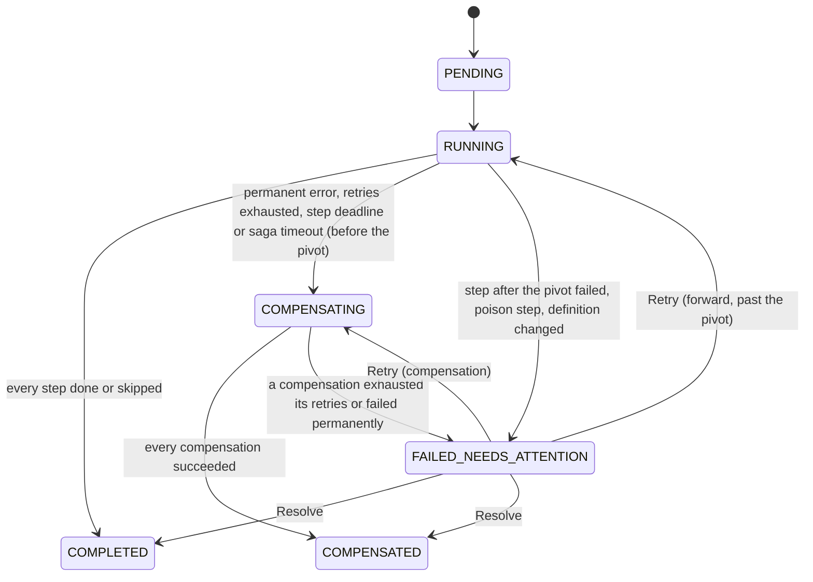

# saga-go

[](https://github.com/victorcondackdev/saga-go/actions/workflows/ci.yml)
[](https://pkg.go.dev/github.com/victorcondackdev/saga-go)

A durable saga orchestrator for payment flows, written in Go with the standard library only.

You declare a flow such as *reserve funds -> send Pix -> confirm settlement -> notify*, together with
its compensations (*release funds*, *request refund*), as typed Go code. The engine runs it as a
persistent state machine. It survives crashes at any point, retries with backoff, undoes completed
work in reverse order when a step fails for good, and never undoes work past the point of no return.
It ships as an embeddable library, an HTTP service (`sagad`) and an operator CLI (`sagactl`), and it
includes a simulator that crashes the engine at every possible point of your own sagas and checks the
invariants.

```go
def := saga.Define[Payout]("pix-payout").
	Step("reserve-funds", reserve, saga.Compensate(release)).
	Step("send-pix", send, saga.Compensate(refund), saga.CompensateAttempted(),
		saga.Retry(saga.RetryPolicy{MaxAttempts: 5}), saga.Timeout(2*time.Second)).
	Step("confirm-settlement", confirm, saga.Pivot(), saga.Deadline(5*time.Minute)).
	Step("notify", notify, saga.Retry(saga.RetryPolicy{MaxAttempts: 12})).
	MustBuild()
```

## Why

**Compared with ad-hoc retries.** A payout handler that calls a ledger, then a PSP, then a notifier
inside one HTTP request, with a retry loop around each call, breaks in predictable ways:

- If the process dies between "PSP accepted the Pix" and "we wrote that down", the money has moved
  and nothing records it. A naive retry then pays twice.
- When the PSP rejects the payment, someone still has to release the hold on the customer's balance,
  in the right order, and that cleanup also needs retries.
- A lost response from the PSP (timeout after the money moved) looks just like a failure.
- Nobody can answer "where is payout 42 stuck, and why?" without reading logs.

saga-go handles these cases. Every transition is persisted before and after a step runs. Steps get a
stable idempotency key so downstream systems can deduplicate. Compensations are first-class and have
their own retry budget. Each saga keeps its full attempt history and can render it as a timeline.

**Compared with Temporal.** Temporal is a general-purpose durable execution platform. It replays your
workflow code from an event history, so workflow code must be deterministic. It runs as a cluster (a
database plus frontend, history and matching services). It offers polyglot SDKs, child workflows,
queries, versioning and a UI. If you need arbitrary long-running workflows across many teams and
languages, use Temporal.

saga-go has a much smaller scope:

| | saga-go | Temporal |
|---|---|---|
| Model | Declared steps (sequential, parallel, conditional) over a JSON-serialisable state struct | Arbitrary code, event-sourced replay |
| Determinism constraints on your code | None: steps are not replayed, only re-run when their outcome is unknown | Workflow code must be deterministic |
| Deployment | A Go library inside your service, or one small binary | A cluster of services plus a database |
| Dependencies | None (standard library) | SDK plus server |
| Persistence | `store.Store` interface: memory, built-in WAL, Postgres mapping documented | Cassandra / MySQL / Postgres via the server |
| Not provided | Child workflows, arbitrary control flow, code versioning (incompatible definition changes are *detected*, not migrated), UI | |

Pick saga-go when the flow is a handful of well-defined steps against systems you control or that
accept idempotency keys, which describes most payment orchestration, and you would rather not run a
cluster to get correct compensations.

## Lifecycle



The engine moves a saga to `FAILED_NEEDS_ATTENTION` only when it cannot safely decide on its own. An
operator takes it from there with `Engine.Retry` (reset the retry budget of whatever failed and resume)
or `Engine.Resolve` (record that it was fixed out of band, with a note kept in the history).
`Engine.Stuck` lists those sagas, plus in-flight sagas that have stopped making progress.

## Guarantees

What the engine guarantees, given a store that honours the `store.Store` contract:

1. **Write-ahead persistence.** An attempt is durably recorded as `RUNNING` before the step function
   is called, and its outcome is durably recorded before the saga moves on. The state struct is
   persisted with the outcome. Changes made by a failed attempt are discarded.
2. **At-least-once execution.** Each step and compensation the saga reaches runs at least once. An
   attempt that was started but never reported back (crash, lost lease, shutdown) is marked
   *abandoned* and run again. It does not consume the retry budget. Until it is re-run the step is
   *in doubt*, and no decision that depends on its outcome is taken: neither the saga timeout nor a
   failing sibling in a parallel group triggers compensation first.
3. **Stable idempotency keys.** `Context.IdempotencyKey()` is `<saga-id>:<step>` for a step and
   `<saga-id>:<step>:compensate` for its compensation. It is identical across attempts, crashes and
   engine processes. *Effectively-once* effects come from the downstream system deduplicating on this
   key. saga-go cannot provide that by itself, and neither can any orchestrator.
4. **Ordering.** Groups run in declaration order. A step starts only after every step of the earlier
   groups has succeeded or been skipped. Once compensation starts, no forward step runs again.
   Compensations run one at a time, in reverse order of their steps' first attempt.
5. **Compensation scope.** A compensation runs only for a step that succeeded. With
   `CompensateAttempted()` it also runs for a step that was attempted at least once, which is meant for
   ambiguous calls. A step that was never attempted is never compensated.
6. **Pivot.** Once the pivot step has durably succeeded, no compensation ever runs for that saga (see
   below).
7. **Fencing.** Instances are leased with heartbeats. Acquiring a lease bumps the instance version,
   which acts as a fencing token, so an engine whose lease was taken over cannot write anything else:
   its next update fails and it stops. When a heartbeat fails, the step's context is cancelled.
8. **Decisions are durable.** A `When` condition is evaluated once and the skip is persisted. Signals
   delivered while another engine holds the lease are not lost, and they wake the saga immediately.
9. **Idempotent start.** `Start` deduplicates on `(type, key)`. Reusing a key with a different input
   is rejected (`ErrKeyConflict`).

What it does **not** guarantee:

- **Isolation between sagas.** Sagas are ACD without the I. Concurrent sagas can observe each other's
  intermediate effects. Use semantic locks in your domain. The hold placed by `reserve-funds` in the
  Pix example is one.
- **That a zombie stops instantly.** A partitioned engine stops *writing* at once, but a step function
  that ignores its context keeps running until it returns. The new owner may run the same step at the
  same time. The idempotency key is what makes that safe.
- **Clock-independent leases.** Leases assume bounded clock skew between engines. A Postgres store
  should use database time.
- **Multi-process access to the WAL store.** The WAL store is for a single process (any number of
  engines inside it). Use a database-backed store to share work across processes.
- **Durability of the memory store** beyond the lifetime of the process.

## Pivot and forward recovery

A payment saga is usually made of three kinds of steps:

- **Compensable steps** can be semantically undone: place a hold, then release it; grant cashback,
  then revoke it.
- **The pivot** is the step after which undoing is no longer possible or no longer makes business
  sense. In the Pix example, capturing the hold after the central bank (SPI) confirmed settlement
  means the money has left. In the boleto example it is liquidation at the bank.
- **Retriable steps** come after the pivot (notify the customer, issue the receipt). They must
  eventually succeed. If they cannot, the right move is to call a human, not to unwind a payment that
  has already happened.

saga-go enforces this structure. A saga has at most one pivot, the pivot cannot have a compensation or
be part of a parallel group, and steps after the pivot cannot declare compensations. These rules are
checked by `Build`. At runtime:

- If the pivot **fails** (permanent error, retries exhausted or deadline), everything before it is
  compensated. A pivot failure must therefore mean that the pivot did not take effect.
- Once the pivot has **durably succeeded**, the saga timeout no longer applies, and a later step that
  exhausts its retries moves the saga to `FAILED_NEEDS_ATTENTION` with the reason "past the pivot,
  forward recovery failed". From there an operator either retries (`Engine.Retry`) or resolves it.

The hard case is an **ambiguous pivot**: the call timed out, so you do not know whether it happened.
The engine never guesses. A timed-out attempt is retried with the same idempotency key, so the pivot
needs to be idempotent, or at least queryable, and only *definitive* answers should become permanent
errors. The same applies one step earlier: `send-pix` can time out after the money moved, which is why
it uses `CompensateAttempted()`. Its compensation requests a refund keyed on the deterministic forward
key, so it can target the payment even if no send attempt ever reported back, and the PSP treats
"nothing to refund" as success.

## Quick start

```go
package main

import (
	"context"
	"errors"
	"time"

	"github.com/victorcondackdev/saga-go/saga"
	"github.com/victorcondackdev/saga-go/store"
)

// ledger, psp, Settlement and ErrInsufficientFunds stand for your own clients and types.

type Payout struct {
	Account string `json:"account"`
	Amount  int64  `json:"amount"`
	HoldID  string `json:"hold_id,omitempty"`
	E2EID   string `json:"e2e_id,omitempty"`
}

func main() {
	ctx := context.Background()
	def := saga.Define[Payout]("payout").
		Step("reserve-funds", func(sc saga.Context, p *Payout) error {
			id, err := ledger.Hold(sc, sc.IdempotencyKey(), p.Account, p.Amount)
			if errors.Is(err, ErrInsufficientFunds) {
				return saga.Permanent(err) // no retry: compensate now
			}
			p.HoldID = id
			return err // other errors are retried with backoff
		}, saga.Compensate(func(sc saga.Context, p *Payout) error {
			return ledger.Release(sc, p.HoldID)
		})).
		Step("send-pix", func(sc saga.Context, p *Payout) error {
			e2e, err := psp.Send(sc, sc.IdempotencyKey(), p.Amount)
			p.E2EID = e2e
			return err
		}, saga.Timeout(2*time.Second), saga.Retry(saga.RetryPolicy{MaxAttempts: 5})).
		Step("confirm-settlement", func(sc saga.Context, p *Payout) error {
			var s Settlement
			if err := sc.Await("settlement", &s); err != nil {
				return err // parked until Engine.Signal delivers the webhook
			}
			return ledger.Capture(sc, p.HoldID)
		}, saga.Pivot(), saga.Deadline(5*time.Minute)).
		MustBuild()

	st, _ := store.OpenWAL(store.WALOptions{Dir: "./data"})
	defer st.Close()
	eng := saga.New(st)
	eng.Register(def)
	go eng.Run(ctx) // worker pool with leases and heartbeats

	id, _ := saga.Start(ctx, eng, def, "payout-42", Payout{Account: "acc-1", Amount: 150_00})
	// ... later, from the PSP webhook handler:
	eng.Signal(ctx, id, "settlement", Settlement{Status: "SETTLED"})
}
```

Fully working versions live in [`examples/pix-payout`](examples/pix-payout) and
[`examples/boleto-payment`](examples/boleto-payment). The boleto example uses a parallel group, a
conditional fraud review and a pivot.

### Service and CLI

```sh
go run ./cmd/sagad -store wal -dir ./data -fail-rate 0.35 &
export SAGAD_URL=http://localhost:8080

go run ./cmd/sagactl start pix-payout -key demo-8 \
  -input '{"payout_id":"8","account":"acc-1","pix_key":"maria@example.com","amount":15000}'
go run ./cmd/sagactl list
go run ./cmd/sagactl timeline sg_4a9f579ea3c697b96130
```

`sagad` registers both examples, wired to mock systems that fail at the rate you choose. Its HTTP API
(package [`httpapi`](httpapi)) covers starting a saga idempotently with an `Idempotency-Key` header,
reading its status, steps and history, the timeline (JSON or `?format=text`), stuck sagas, signals,
manual retry and resolve, `/metrics` and `/healthz`. Kill it with `kill -9` while sagas are in flight
and start it again on the same `-dir`: the WAL is recovered, expired leases are taken over and every
saga reaches a resting state.

### Execution timeline

Every attempt is in the saga's history with timestamps, duration and error. `sagactl timeline`
renders it on a shared time axis. This is real output from the service with a 35% failure rate in the
mock systems: settlement was rejected by SPI, and the refund request itself failed once before it
succeeded:

```
saga sg_4a9f579ea3c697b96130  type=pix-payout  status=COMPENSATED  span=1.799s
failure: step "confirm-settlement" failed: permanent: settlement REJECTED: AC03 creditor account invalid
                                    |0s--------------------------------1.799s|
* saga_created                      |+                                       |   key=demo-8
* saga_started                      |+                                       |
reserve-funds         #1  ok        |>                                       | 485µs
send-pix              #1  ok        |>                                       | 1.9ms
confirm-settlement    #1  failed    |~~~~~~~~~~~~~~~~~~~~~~~~~~~~~~~~~x      | 1.504s  permanent: settlement REJECTED: AC03 creditor account invalid
* signal_received                   |                                 +      |   settlement
* saga_compensating                 |                                 +      |   step "confirm-settlement" failed: permanent: settlement REJECTED: AC03 creditor account invalid
<- send-pix           #1  retry     |                                 !      | 8.1ms  psp: 503 service unavailable
<- send-pix           #2  ok        |                                      > | 1.8ms
<- reserve-funds      #1  ok        |                                      > | 4.1ms
* saga_compensated                  |                                       +|   step "confirm-settlement" failed: permanent: settlement REJECTED: AC03 creditor account invalid
```

`=` marks an attempt, `~` time parked on a signal, `>` success, `!` a retry, `x` a final failure, `?`
an attempt abandoned by a crashed worker, and `<-` a compensation. A crash shows up as an `abandoned`
row followed by a `lease_takeover` milestone that names the previous owner. In practice this is the
first view you open when a saga is stuck.

## Testing your sagas: `sagatest`

Most saga bugs live in the windows between "the side effect happened" and "we recorded it".
`sagatest.Explore` tests those windows exhaustively. It runs your definition, with your step functions
and fakes, against an in-memory store and a fake clock:

1. A clean run counts every crash point the engine passes. These are before an attempt is recorded,
   after it is recorded but before the call, after the call but before the outcome is persisted, after
   the outcome is persisted, the same four for compensations, before a parallel merge, before
   suspending, and before the terminal write.
2. Each following run crashes at one of those points, or at every combination of up to `Depth`
   points, so crashes during the recovery of a crash are covered too. A fresh engine takes over after
   the lease expires and drives the saga to rest. Signals are delivered by your harness, or never, so
   the polling fallback and the deadlines also get exercised.
3. After every run it checks the engine invariants (stable idempotency keys, ordering, compensation
   only of attempted steps, reverse order, pivot respected, every succeeded compensable step
   compensated when the saga ends `COMPENSATED`) plus your own domain checks.

```go
func TestPayoutCrashSafety(t *testing.T) {
	rep := sagatest.Explore(t, sagatest.Config{Depth: 2, Seeds: []uint64{1, 2, 3}},
		func(seed uint64) sagatest.Harness[payout.Payout] {
			w := newWorld(seed) // fresh fakes, failures drawn from the seed
			return sagatest.Harness[payout.Payout]{
				Definition: payout.NewDefinition(w.deps()),
				Input:      payout.Payout{Account: "acc-1", Amount: 250_00},
				Signal:     func(name string, p payout.Payout) (any, bool) { return w.psp.Settle(p.SendKey) },
				Check: func(t testing.TB, o *sagatest.Outcome[payout.Payout]) {
					// money moved exactly once, or not at all
				},
			}
		})
	t.Log(rep) // 5442 runs, 31 crash points in the clean run, ...
}
```

The simulator is deterministic for a given seed and crash plan, and a failure prints the crash sites,
every invocation and the timeline. It finds real bugs. The test suite shows it catching a step that is
not idempotent (a second hold after a crash) and a step whose retry returns a different answer than
the first call (its effect is never compensated).

Coverage of the shipped examples (12 and 10 seeds, `Depth: 2`, with random PSP failures, lost
responses, lost webhooks, settlement rejections, fraud denials and bank rejections):

| Scenario | Runs | Outcomes |
|---|---|---|
| pix-payout | 5,442 | 4,906 completed, 536 compensated |
| boleto-payment, R$ 1.200,00 (no fraud review) | 4,642 | 4,642 completed |
| boleto-payment, R$ 7.500,00 (fraud review) | 6,388 | 4,251 completed, 2,137 compensated |
| boleto-payment, bank rejects (pivot fails) | 872 | 872 compensated |

## Observability

- **Hooks**: `saga.WithHook` receives every history event *after* it is durably persisted, so you can
  feed an outbox or a stream.
- **Invocation observers**: `saga.WithInvocationObserver` sees every call to a step or compensation
  (key, attempt, start, end, error), which is a natural place to open tracing spans.
- **Logs**: `log/slog`, with `saga_id`, `saga_type`, `step` and `attempt` on every line.
  `Context.Logger()` gives steps a logger that already carries those attributes. Retries are logged at
  warn and sagas that need attention at error.
- **Metrics** (`Engine.WritePrometheus`, `/metrics` in `sagad`): `saga_instances{status}`,
  `saga_started_total`, `saga_finished_total{status}`, `saga_step_attempts_total{result}`,
  `saga_step_retries_total`, `saga_compensations_total{result}`,
  `saga_step_duration_seconds{phase}` (histogram), `saga_lease_takeovers_total` and
  `saga_lease_lost_total`.

## Benchmarks

A four-step saga (two compensable steps, a pivot and a notification, all no-ops), so the numbers
measure the engine and the store. They were taken with `go test ./saga -bench . -benchtime 3s` on 2
vCPUs (Intel Xeon @ 2.10GHz), Go 1.24.7, linux/amd64. `Run` used 16 workers with up to 256 sagas in
flight.

| Configuration | sagas/s | per saga | allocs/saga |
|---|---|---|---|
| `Tick`, serial, memory store | 16,006 | 62 µs | 163 |
| `Run`, memory store | 11,976 | 83 µs | 168 |
| `Run`, WAL store, `SyncNever` | 2,280 | 439 µs | 623 |
| `Run`, WAL store, `SyncAlways` (fsync, group commit) | 766 | 1.3 ms | 556 |

Each saga does about 12 durable writes (write-ahead plus outcome for each of the four steps, plus
start and finish), so `SyncAlways` is roughly 9,000 fsync-acknowledged writes per second on this
machine, thanks to group commit. The WAL store writes a full JSON snapshot of the instance on every
update. That keeps recovery trivial, but it is the dominant cost, and it is the first thing to change
for long sagas. The design notes below cover it.

## Design notes

- **State machine, not replay.** The engine persists *where* the saga is (cursor, per-step records)
  and *what* it holds (your state struct as JSON), not an event log to replay. Step code therefore has
  no determinism constraints. The cost is that the shape of a definition is part of the persisted
  contract: each instance stores a hash of its definition, and an engine with an incompatible
  definition parks the instance in `FAILED_NEEDS_ATTENTION` instead of guessing. To change a flow,
  register a new type name and let old instances drain.
- **Durable timers.** Backoff and signal waits are not sleeps. The instance is persisted with
  `NextRunAt` and its lease is released, so a backoff of an hour costs nothing, and any engine can
  pick the saga up when it is due.
- **In doubt beats fast.** After a crash, the engine re-runs an abandoned attempt to learn its outcome
  before taking any decision that depends on it. A step that keeps killing its worker is a poison
  pill: after `WithMaxAbandoned` abandoned attempts the saga goes to `FAILED_NEEDS_ATTENTION`, not to
  compensation, because its effect is unknown.
- **Parallel groups** give each branch its own copy of the state and merge top-level JSON fields in
  declaration order. Two branches writing the same field with different values is a definition bug,
  so it fails the group and triggers compensation rather than silently letting one write win.
  `WithSerialGroups` runs branches in order (the durable semantics are the same), which the simulator
  relies on.
- **Leases and fencing.** `Acquire` bumps the version, `Heartbeat` does not. An engine that lost its
  lease finds out on its next write (`ErrConflict`) or its next heartbeat, and cancels in-flight work.
  This is the same protocol the Postgres mapping implements with `SELECT ... FOR UPDATE SKIP LOCKED`.
- **WAL store.** It uses append-only segments framed as `len | crc32c(len, data) | data`. A torn record
  at the tail of the newest segment is truncated on open. Corruption anywhere else is reported, never
  silently dropped, because a segment is fsynced before its successor is created. Concurrent writers
  share fsyncs (group commit). Compaction rewrites live snapshots into a fresh segment and deletes the
  old ones, and it is crash-safe at every point because each compacted record supersedes everything
  before it. The tests cut the log at random byte offsets and check that recovery yields exactly the
  state after the last complete record. The decoder and the whole recovery path are fuzzed.
- **Postgres.** [`migrations/postgres.sql`](migrations/postgres.sql) shows how the `Store` contract maps
  to tables, with history and signals in separate append-only tables (avoiding the snapshot cost
  mentioned above) and the leasing query. It is a reference and **is not tested here**, since the
  module has no dependencies.

## Layout

```
saga/              definitions, engine, retries, signals, metrics, timeline
store/             Store interface, Memory, WAL (store/internal/wal: segmented log)
sagatest/          deterministic crash-point simulator and invariant checks
httpapi/           HTTP/JSON API over an Engine
cmd/sagad/         service: API + worker pool + demo saga types
cmd/sagactl/       operator CLI
examples/          pix-payout, boleto-payment (with exhaustive crash tests)
migrations/        reference PostgreSQL schema
internal/metrics/  Prometheus text-format registry
```

## Development

```sh
gofmt -l . && go vet ./... && go test -race ./...
go test ./store -run '^$' -fuzz FuzzOpenWAL -fuzztime 15s
go test ./store/internal/wal -run '^$' -fuzz FuzzDecodeRecord -fuzztime 15s
go test ./saga -run '^$' -bench . -benchmem
```

Requires Go 1.22 or later. No third-party modules.

## License

MIT. See [LICENSE](LICENSE).
